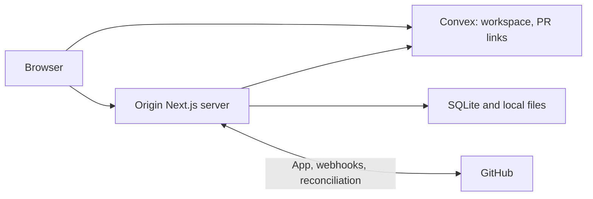

<div align="center">

<h1>Origin</h1>

<p><strong>Your team, one workspace.</strong><br />
Projects, issues, chat, calls, and a shared canvas.<br />
Use the web app on your own infrastructure.</p>

<p>
  <a href="#run-locally">Run locally</a> ·
  <a href="deploy/README.md">Self-host</a>
</p>

</div>

Origin is an open-source, self-hosted workspace.
Running your own instance does not require a public hosted Origin account.

## What you can do

| Feature | What exists |
| --- | --- |
| Workspace | Projects, editable workflows, issues, comments, dependencies, due dates, labels, files, project assets and an encrypted vault. |
| Multiplayer | Chat and DMs, search, mentions, audio/video calls, screen sharing, presence, and a shared Excalidraw canvas. |
| Tasks → PRs | Pull requests linked to tasks, check and review state, and merge-driven completion. GitHub setup is required. |
| Feedback and MCP | Opt-in public project feedback and a scoped OAuth MCP connector for external AI clients. |

## Quick start

### Self-host

Follow [Deploy Origin](deploy/README.md) for Convex, the web container, persistent storage,
HTTPS, GitHub, email and TURN. Create your account and workspace, invite your team, then create a project.

## Run locally

Requirements: Node.js 24, npm, and a Convex deployment. No model API key is required for the workspace.

```sh
git clone https://github.com/z4mbo/origin-workspace.git
cd origin-workspace
npm ci --legacy-peer-deps
cp .env.example .env.local
npx convex dev
```

Follow the Convex CLI setup and keep it running. It writes your deployment URLs to `.env.local`.
In a second terminal, from the same checkout:

```sh
npm run dev
```

Open `http://localhost:3000/signup` and create your first workspace. There are no seeded accounts,
default passwords, or bundled user data. In PowerShell use `npm.cmd` / `npx.cmd` if script execution
is blocked, and `Copy-Item .env.example .env.local` in place of `cp`.

Board, drawing, feedback and account data use Convex. Chat, attachments,
call signaling and integration credentials use the Node server's local data directory;
project assets use Convex storage. GitHub/MCP server actions need the shared integration
secret in the [deployment guide](deploy/README.md). Camera and screen capture need HTTPS outside localhost.

For invite-only sign-up, create your account first, then set this on the intended Convex deployment:

```sh
npx convex env set ORIGIN_SIGNUP_MODE invite
```

Workspace content is private to its members. Public feedback exposes only the portal content
an admin enables. Publishing the source never publishes your workspace data.

## GitHub and external AI clients

Connect GitHub in workspace settings and approve the project's repository. Existing GitHub issue
sync remains available. For PR-driven tasks, opening a PR moves work to review when configured;
**only a verified merge completes it automatically**. Closing an unmerged PR or a linked GitHub
issue does not complete a PR-driven task.

The OAuth endpoint at `/api/mcp` lets external clients read authorized projects, issues and inbox
events and optionally change issues. It does not expose chat, vault secrets or arbitrary execution.
See the [MCP guide](docs/claude-origin.md) and [Codex plugin](plugins/origin/README.md).

## Architecture



The standard deployment uses managed Convex; deploying the web container alone does not self-host
that database. Calls use WebRTC, with optional self-hosted TURN.

## Documentation and development

- [Testing](docs/testing.md) · [Contributing](CONTRIBUTING.md)

```sh
npm run typecheck
npm test
npm run build
```

Integration tests use isolated localhost fixtures. Never point development/test commands at live
workspace data.
Origin remains an early beta: email verification, self-service password recovery, enterprise SSO,
and independent security certification are not provided. Email invitations need SMTP; link invites do not.
Report bugs without credentials or private data; see [SECURITY.md](SECURITY.md).

## License

Original Origin code is MIT; dependencies retain their licenses. See [LICENSE](LICENSE) and [THIRD_PARTY_NOTICES.md](THIRD_PARTY_NOTICES.md).
