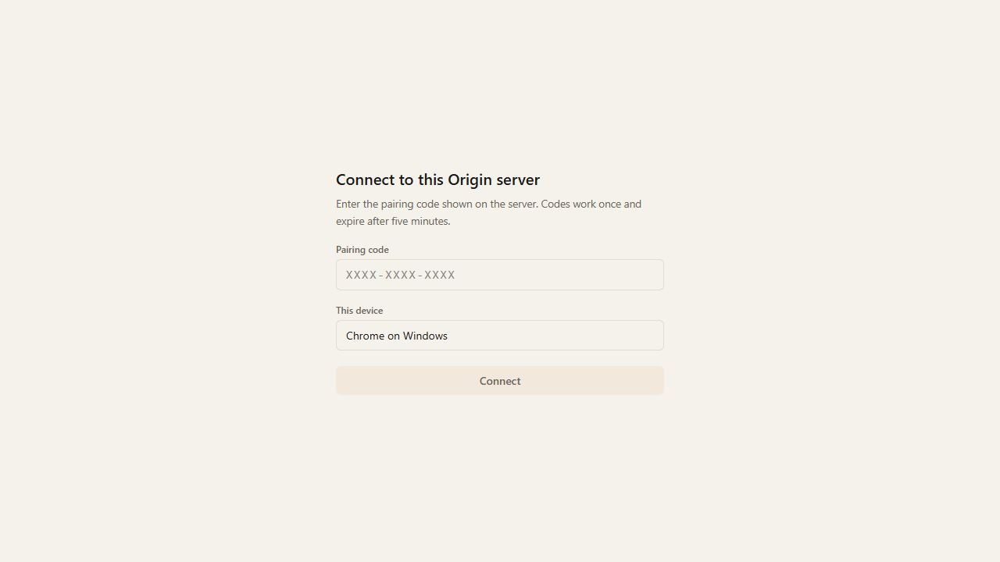
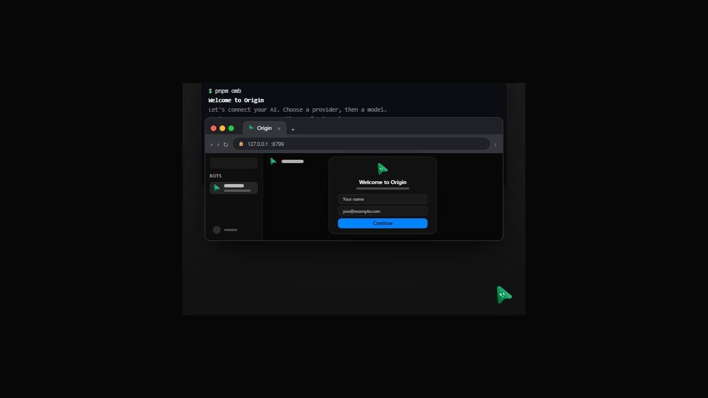
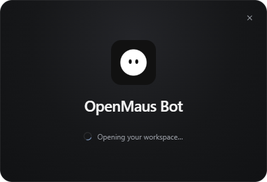
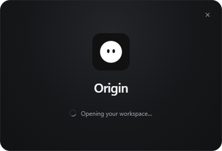

# Origin product identity

This inspection starts from `87ff77be5ea79272175219d479b9a8017b4e8fcc` in an isolated worktree. It covers product copy, native startup and tray labels, the web app manifest, agent instructions, CLI/MCP messages, pairing/onboarding help, and the twelve locale catalogs. It does not rename persistent identifiers or claim an Origin subscription service exists.

## Proven scenarios

| Scenario | Before | Result | Severity |
| --- | --- | --- | --- |
| Launch the desktop loading window, then inspect its tray | The loading heading/window title and tray actions named OpenMausBot while the app was Origin | `APP_NAME` from `shared/product-brand.mjs` supplies Origin; the packaged file list includes that shared module | P2 |
| Install the phone web app | `manifest.webmanifest` installed it as OpenMausBot | Name and short name are Origin; identity/start URL/scope remain unchanged | P2 |
| Start a new agent or view its system prompt | Its persona said it was a personal bot in OpenMausBot | Persona and product-owned agent/tool messages identify Origin | P2 |
| Use the CLI onboarding example from an Origin checkout | The example ran `npx openmausbot`, which selects the upstream package | The example and translated instructions use the repository's `pnpm omb` script | P2 |
| Open an unpaired connection without a descriptor | The heading said “Connect to this OpenMausBot” | It says “Connect to this Origin server” | P3 |
| Open a hosted workspace whose link expired | Help pointed to Settings → MausBot Cloud and an upstream Plan page | It requests a fresh connection link/code from the actual workspace host | P2 |
| Use the app within the upstream Product Hunt launch window | The card said Origin had launched, but Upvote opened the upstream MausBot campaign | The upstream campaign card and queue entry are removed; no replacement campaign is invented | P2 |

The copy change also updates app-owned errors, provider recovery instructions, backup/package errors, notifications, provenance and agent context headers. Help links for API keys, self-hosting, Linux desktop control and tool selection point to the existing Origin repository documents. OpenAI usage limits are described independently of cloud-computer billing; ChatGPT revocation points to this app's access rather than guessing its third-party display name.

## Compatibility and security

New Origin provenance is recognized alongside persisted OpenMausBot messages. Author parsing, rendered provenance, retryable phone errors, restart-health classification and structured API refusals accept both forms. Header escaping recognizes Origin, including the existing Unicode/Markdown normalization path, so changing the visible header does not make a model-authored header trusted.

The new focused cases ran against the original five production modules and failed **10 cases**, with four legacy controls passing. Restoring the changed production bytes made all **14 selected cases pass**. The unchanged source restoration was checked by SHA-256. See [before](evidence/origin-branding-034/brand-regressions-before.log) and [after](evidence/origin-branding-034/brand-regressions-after.log).

These names intentionally remain:

- Crypto context `OpenMausBot phone credential v1`, authentication headers, environment/IPC keys, wire format values, storage keys, package format names and legacy executable/service/bundle identifiers.
- The existing `Documents/MausBot` output folder and speech-helper bundle path, which require migrations to rename safely.
- Genuine upstream account/control-plane/mobile applications, upstream dependency URLs, provider labels and compatibility-only MausBot Cloud UI. Origin disables the upstream commercial bridges in the separate Cloud change; this branding change must not rename its intentional `app.getName() === "OpenMausBot"` vendor identity gate.
- Copyright/license notices, upstream adoption credits and historical attribution. The npm-package generator and legacy Linux package fixtures still describe their real upstream package identities.
- The decision relay's exact `KEY_CHECK_STATE.purpose` wire value. Its existing contract fixture refused the renamed Origin value; the producer is restored to the required upstream payload rather than changing that contract assertion.

The first literal inventory and reviewed exclusions are retained in [product-copy-edit-inventory.json](evidence/origin-branding-034/product-copy-edit-inventory.json). Later JSX, CLI/MCP, API parsing and translated-message corrections are recorded by the supplemental inventories and the historical checkpoint [source snapshot](evidence/origin-branding-034/source-snapshot.json). The initial 322 literal spans across 113 files are an intermediate inventory, not a claim that the entire final patch has only those edits.

The snapshot's recorded artifact-manifest hash beginning `06466dd6` and its self-reference are historical checkpoint values. They are not current manifest or self-hash assertions. The [034 committed-blob integrity review](origin-backend-reuse-034.md) verifies the refreshed 63-payload artifact manifest independently; the captured snapshot itself remains unchanged.

## Actual visual checks

`node --experimental-strip-types scripts/verify-origin-branding.ts` starts its own fake-engine fixture and two Vite previews. The before preview loads the two affected components from the frozen baseline; the after preview loads current source. A fixture-only unpaired session and failed descriptor keep account data out of both views. Network policy limits connection requests to the fixture origin and prevents form submissions.

The actual browser check used **1280 × 720**. It covered the pairing view in light theme and CLI onboarding in dark theme. The after onboarding DOM contained `$ pnpm omb`, “Welcome to Origin”, and had `scrollWidth === innerWidth`. This is bounded component verification; it is not a 375px/full-app/package acceptance claim. The browser tab, both previews and the owned fake server were closed; no owned listener remained on their three ports.

| Pairing before | Pairing after |
| --- | --- |
|  |  |

| Onboarding before | Onboarding after |
| --- | --- |
|  |  |

The native `scripts/verify-startup-tray.mjs` recipe separately exercised a sandboxed Electron loading renderer, close-to-tray, content mounting, restore and quit on Windows, before and after. It retained 440 × 300 loading screenshots and receipts. This did not install a package or exercise an updater, provider or full application.

| Startup before | Startup after |
| --- | --- |
|  |  |

## Validation boundary

The desktop regression was 1 failed/11 passed before and 12 passed after. PWA naming was 1 failed/1 passed before and 2 passed after. The campaign regression was 1 failed/12 passed before and the complete two-file notice suite passed 20 cases afterward. Agent/provenance/package focused validation passed 349 cases across ten files. TypeScript client/server checks, all locale catalogs, full lint and 84 documentation/CI guard tests passed; retained outputs accompany this report.

The first 103-file diagnostic reached its explicit 480-second child timeout and has no final test summary. Its partial failures are not a successful suite result. The subsequent finite 128-file run completed with **4,141 passed, 16 failed and 49 skipped**. Fourteen failures were current presentation expectations; after correcting those expectations (and making one remaining relay message generic), the exact fourteen cases passed across ten files. That focused run did not rerun the entire suite. No assertions, approval identifiers, scope checks or security controls were removed to make the copy match.

Two failures remain on this Windows host: existing backup fixtures cannot create file symlinks (`EPERM`) at their setup lines 560 and 585, before calling the backup operation. Both failures were reproduced with the exact original `87ff77be…` production module loaded through a temporary, load-only Vite override; the test file has no diff. The original source receipt records SHA-256 `7147ce5e6eb8b27dcb4c01c0cd845998e8d8daaf5f9eecc65a92bd84c693994a`. The tests were not skipped, suppressed or weakened. These checks still need a host with file-symlink permission; this report does **not** claim a fully green 128-file run.

The [test receipt](evidence/origin-branding-034/touched-test-result.json) retains the exact failed/passed case sets and the [artifact manifest](evidence/origin-branding-034/artifact-manifest.json) hashes the logs, screenshots and source inventory. Code is committed as `52fe303099ff5c75b0ec8195c8b5cda7fb582938`, after the separate startup/tray, campaign-removal and PWA-name commits. Post-correction server typechecking and lint passed. No production data, main-checkout dev server, Convex process, credential or provider account was used. No push, deployment or release publication is part of this isolated change.

## Final compatibility review

Independent review found that persisted interrupted assignments with zero reruns could lose their outward-action warning: their stored detail began “Interrupted by an OpenMausBot restart…”, while the reader accepted only Origin. The new both-name regression failed for the old name and passed for the current name before the fix. The reader now accepts both exact prefixes and still emits Origin. The three affected runtime/coordinator/room-root files passed all **87 cases**. The unchanged external relay contract separately failed one selected case before restoring its exact wire value and passed all **six cases** afterward.

A finite independent inventory then identified 22 additional files with current-producer expectations. Only those reviewed output assertions and shared output matchers were updated. Supplied hostile legacy inputs, their literal escaped echoes, the vendor relay contract, genuine provider labels and the existing macOS failure input were preserved. A 21-file selector passed 32 selected cases; its HighLevel case failed because the selector omitted the connection established by that file's first test. The unchanged complete two-test HighLevel file then passed. The conditional macOS assertion was not executed on Windows. The six Live-call copy assertions require validation against the parent integration's separately owned Live-call producer; this worktree does not claim that integrated check.

The follow-up code is `8f90fae328b1ba6ab28c21c99663b5f3edd41ecb`. The [follow-up receipt](evidence/origin-branding-034/compatibility-follow-up.json) records the exact boundaries. A folder-scoped `-text` attribute preserves evidence bytes; its artifact manifest uses forward-slash paths, records raw byte hashes and is checked against staged Git blobs. No new full-suite success is inferred from these focused checks.
